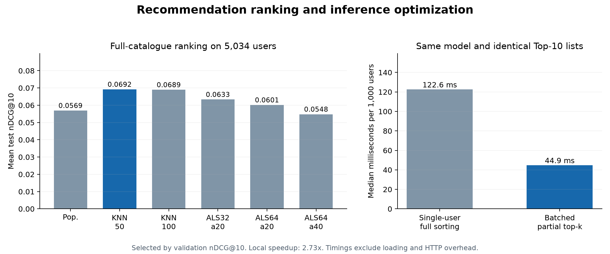

# Recommendation Ranking and Inference Optimization

A reproducible recommendation benchmark that processes MovieLens 1M ratings, implements popularity, item-neighbour, and weighted implicit matrix-factorization models, and measures an exact batch-ranking optimization. It includes full-catalogue evaluation, a candidate-sampling diagnostic, correctness checks, and a local recommendation API.

## Measured results

- Processed **1,000,209 ratings** from **6,040 users**, with a static catalogue of **3,883 movies**.
- Evaluated **six fixed model configurations** on strict per-user temporal holdouts for **5,034 eligible users**.
- Selected **Item-KNN 50** using validation nDCG@10.
- Full-catalogue test nDCG@10 improved from **0.0569** for popularity to **0.0692**, a **21.6% relative increase**.
- A 1,000-user ranking workload fell from **122.6 ms** to **44.9 ms**, a **2.73x median speedup**, with **100% identical Top-10 lists**.



See [RESULTS.md](RESULTS.md), [all model comparisons](artifacts/model_comparison.csv), [recorded metrics](artifacts/metrics.json), and the [protocol specified before evaluation](EXPERIMENT_SPEC.md).

These are offline benchmark and local timing results. nDCG is a ranking metric, not classification accuracy or a probability of a user liking a recommendation.

## Experiment design

Ratings >=4 are transformed into binary positive preferences. For each user, positive-event timestamp cutoffs are chosen at the 80th and 90th percentiles of their positive sequence. Timestamp ties move into the later block. Evaluated users must have at least 20 positive ratings and strict nonempty training, validation, and test blocks, with at least five training positives.

For evaluated users, the training preference matrix and all-rating seen-item filter include events only before that user's validation cutoff. Low ratings before the cutoff are excluded from recommendations too. Model parameters and filters stay frozen through validation and test. Users who fail the ranking criteria contribute their available positives to training and are explicitly counted as excluded from ranking evaluation.

**Scope:** this is a per-user temporal, transductive benchmark. Other users' training events can be later than one user's held-out events. It is not a global chronological deployment simulation. The catalogue is static; item availability by release date is not modeled.

Headline metrics rank against the full catalogue. Cold-item holdouts remain in the denominator. A separate diagnostic shows how evaluation changes when using all relevant items plus 100 sampled negatives per user. That easier diagnostic is not used as the headline score.

## Models

| Family | Fixed configurations |
|---|---|
| Popularity | Positive-event counts from training only |
| Item-neighbour | Cosine co-occurrence similarity, shrinkage 10, 50 or 100 neighbours |
| Weighted implicit ALS | 32/64 factors, confidence alpha 20/40, regularization 0.1, 10 iterations, seed 42 |

ALS is implemented from the published weighted normal equations using NumPy linear solves. The implementation checks that the weighted objective decreases. It reuses an established method; it does not introduce a novel factorization algorithm. The selected item-neighbour model outperformed the ALS candidates for nDCG in this experiment, while the ALS models produced broader catalogue coverage.

Model selection uses mean validation nDCG@10. Test comparisons are calculated after selection is frozen. A paired bootstrap over 1,000 resamples of evaluation users estimates the selected model's nDCG difference from popularity. The interval is conditional on these fitted models and this dataset.

## Ranking optimization

The reference scores and fully sorts one user at a time. The optimized implementation scores users in batches of 64 and uses partial top-k selection, with explicit tie handling by item index. Both exclude the same seen items.

The benchmark uses the same model and 1,000 fixed sampled users, k=10, two CPU threads, seven repetitions, and alternating timing order. It checks complete Top-10 list agreement and finite-score differences. Timing includes scoring, filtering, and ranking, while excluding loading and HTTP overhead. It is not a concurrent production traffic or per-request tail-latency benchmark. The larger intermediate batch score matrix is an explicit memory tradeoff.

## Quick start

Use **Python 3.12**, the tested version.

```bash
git clone https://github.com/WhiteDevil377/recommendation-ranking.git
cd recommendation-ranking
python3 -m venv .venv
source .venv/bin/activate
python -m pip install -r requirements.txt
python experiment.py
python write_report.py
python verify.py
```

On Windows, activate with `.venv\Scripts\activate`. The experiment downloads MovieLens 1M directly from GroupLens if absent, builds the sparse matrices, trains the candidates, evaluates them, and saves a local model bundle. Raw data and trained user/item profile matrices are excluded from Git.

### Recommend from the command line

```bash
python recommend.py --user-id 1 --k 10
```

### Local API

```bash
python serve.py --port 8767
curl 'http://127.0.0.1:8767/recommend?user_id=1&k=10'
curl -X POST http://127.0.0.1:8767/recommend \
  -H 'Content-Type: application/json' \
  -d '{"user_ids": [1, 2, 999999], "k": 10}'
```

The service supports known-user recommendations and popularity fallback for unknown users or users without positive training feedback. The API is a local research demonstration.

## Verification

`verify.py` compares the sparse ALS objective and updates against independent dense toy calculations, checks objective descent, tests exact top-k tie handling against full sorting, verifies a hand-computed ranking metric, checks strict per-user time boundaries and holdout disjointness, confirms seen-item exclusion, tests cold-user fallback, and exercises real API success and invalid-input responses.

The public artifacts are aggregate reports. Source ratings, demographic files, user-level evaluation rows, and trained profile matrices are not redistributed. The preparation code does not load the demographic file.

## Limitations and next experiments

The reported ranking cohort excludes 1,006 users who do not meet the declared criteria. Results are conditional on the transformed positive-preference task and this historical benchmark. Unobserved movies are not proven negative preferences. Sparse catalogue coverage, cold items, selection bias, and the gap between offline ranking and real engagement remain relevant limitations.

Useful extensions include a genuine global-time deployment split, feedback updates between evaluation windows, a larger catalogue, content-based cold-item modeling, or quality/diversity tradeoffs. No online engagement, revenue uplift, state-of-the-art performance, production-scale deployment, or guaranteed hiring result is claimed.

## Sources and data terms

- [GroupLens MovieLens 1M](https://grouplens.org/datasets/movielens/1m/).
- Harper and Konstan (2015), [The MovieLens Datasets: History and Context](https://doi.org/10.1145/2827872).
- [GroupLens dataset usage conditions](https://files.grouplens.org/datasets/movielens/ml-1m-README.txt). This repository is a research prototype; users obtain the data from GroupLens under its conditions. No source data is redistributed or GroupLens endorsement implied.
- Hu, Koren, and Volinsky (2008), [Collaborative Filtering for Implicit Feedback Datasets](https://yifanhu.net/PUB/cf.pdf).
