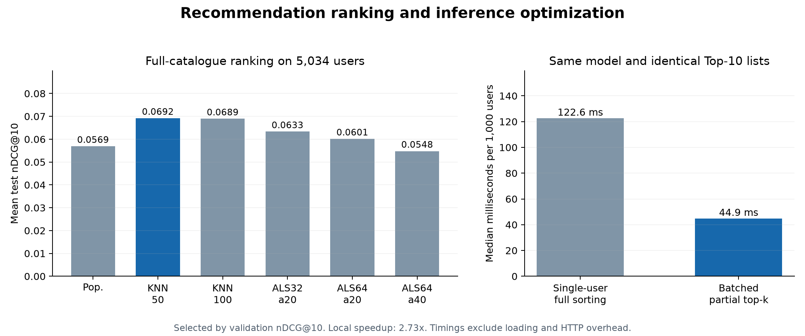

# Measured recommendation results

Generated on 9 November 2026 from the bundled implementation.

Processed 1,000,209 source ratings from 6,040 users. Ranked the static catalogue of 3,883 movies for 5,034 eligible users. 1,006 users did not meet the declared ranking criteria and are counted in the data audit.

## Frozen model comparison

| Method | Validation nDCG@10 | Test nDCG@10 | Test Recall@10 | Test MRR@10 | Catalogue coverage |
|---|---:|---:|---:|---:|---:|
| Popularity | 0.0679 | 0.0569 | 0.0434 | 0.1198 | 2.99% |
| Item-KNN 50 | 0.0900 | 0.0692 | 0.0562 | 0.1415 | 7.34% |
| Item-KNN 100 | 0.0881 | 0.0689 | 0.0556 | 0.1408 | 6.62% |
| ALS 32 / alpha20 | 0.0769 | 0.0633 | 0.0556 | 0.1303 | 34.43% |
| ALS 64 / alpha20 | 0.0783 | 0.0601 | 0.0539 | 0.1239 | 37.39% |
| ALS 64 / alpha40 | 0.0696 | 0.0548 | 0.0507 | 0.1153 | 41.21% |

Selected **Item-KNN 50** by validation mean nDCG@10. The model and seen-item filter remained frozen through evaluation. ALS did not outperform the selected item-neighbour model in this experiment; its higher catalogue coverage is retained in the comparison.

Full-catalogue test nDCG@10 increased from **0.0569** to **0.0692**, a **21.6% relative increase**. Absolute paired mean difference: **0.0123**, with a 95% user-bootstrap interval **[0.0095, 0.0150]** from 1,000 resamples. This interval is conditional on the fitted models and this fixed benchmark, not an external-data guarantee.

## Optimization workload

| Implementation | Median milliseconds | p95 across seven repetitions |
|---|---:|---:|
| reference | 122.64 | 123.87 |
| optimized | 44.90 | 45.00 |

Workload: 1,000 fixed eligible users, k=10, batch size 64, 2 CPU threads, alternating timing order. Median speedup: **2.73x**. Exact Top-10 list agreement: **100%**. Maximum finite score difference: **0**.

A full batch score matrix uses 1,988,096 bytes; this is one intermediate matrix, not total process memory. The benchmark measures a warm local ranking workload, excluding model loading, HTTP overhead, and concurrent production traffic.

## Candidate-sampling diagnostic

On the same selected model, replacing the full catalogue with all relevant items plus 100 sampled unseen nonrelevant items per user changes nDCG@10 from **0.0692** to **0.5452**. The sampled result is a different, easier evaluation protocol and is not the headline performance claim.

## Scope and data quality

This is a per-user temporal, transductive benchmark. Other users' training events can occur later than a particular user's evaluation events. It is not a global chronological deployment simulation. Timestamp ties are assigned to later blocks; held-out positives are disjoint from the user's training history. Lower-rated items observed before the cutoff are also filtered from recommendations.

Training positive events: 458,078. Validation positives: 56,372. Test positives: 60,831. Held-out test positives without a training-supported item: 66; these remain in the metric denominator.

Explicit ratings >=4 are transformed into positive preferences. Unobserved pairs are not proven negative preferences. No online engagement, revenue uplift, production-scale deployment, or novel algorithm is demonstrated.

## Reproducibility and sources

Source archive SHA-256: `a6898adb50b9ca05aa231689da44c217cb524e7ebd39d264c56e2832f2c54e20`.

GroupLens MovieLens 1M: https://grouplens.org/datasets/movielens/1m/. Harper and Konstan (2015), https://doi.org/10.1145/2827872. Dataset terms: https://files.grouplens.org/datasets/movielens/ml-1m-README.txt. Hu, Koren, and Volinsky (2008), Collaborative Filtering for Implicit Feedback Datasets: https://yifanhu.net/PUB/cf.pdf.

The public repository includes code and aggregate experiment outputs. Raw data and trained profile matrices are excluded; users download the source directly under GroupLens terms. No GroupLens endorsement is implied.
